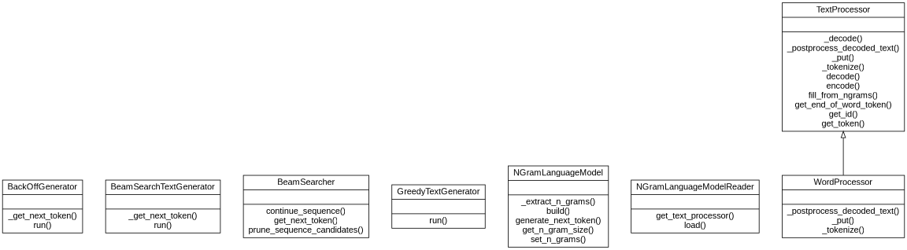
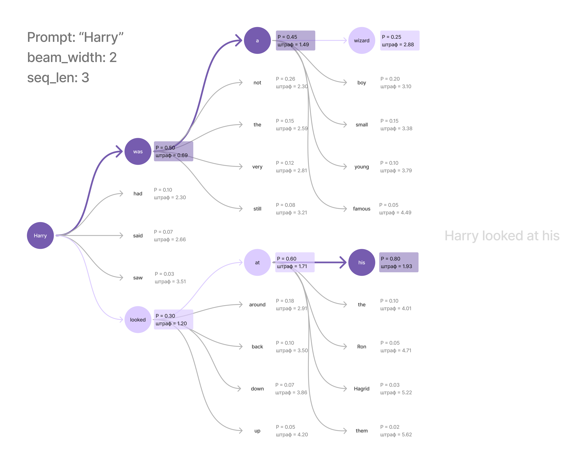

Лабораторная работа №3. Генерация текста с помощью n-грамм
==========================================================

.. toctree::
    :maxdepth: 1
    :titlesonly:
    :caption: Full API

    lab_3_generate_by_ngrams.api.rst

Дано
----

1. Текст на английском языке (``assets/Harry_Potter.txt``),
   который загружен и сохранен в переменную ``text`` в ``start.py``.
2. Языковой профиль английского языка (``assets/en_own.json``).

UML-диаграмма
-------------

**Генерация текста** — одна из прикладных задач обработки естественного языка
(Natural Language Processing, NLP). На данный момент существует
много больших языковых моделей, которые могут генерировать тексты,
близкие к написанным человеком.

Задача генерации текста реализует возможность языковой модели
на основе исходного текста предсказывать последующее слово и генерировать осмысленный
текст.

Существуют различные алгоритмы, позволяющие генерировать последовательности. По ходу
выполнения лабораторной работы Вы познакомитесь с тремя алгоритмами:

1. `Greedy Algorithm <https://en.wikipedia.org/wiki/Greedy_algorithm>`__
2. `Beam Search Algorithm <https://en.wikipedia.org/wiki/Beam_search>`__
3. `BackOff Algorithm <https://en.wikipedia.org/wiki/Katz%27s_back-off_model>`__

Терминология
------------

В рамках лабораторной работы Вы будете работать с n-граммами.

.. glossary::
   :sorted:

   N-граммы
      Последовательность из n элементов, включенная в другую
      последовательность.

В настоящей лабораторной мы будем работать с n-граммами,
состоящими из закодированных токенов текста.

Допустим, у нас есть следующий закодированный текст:
``(1, 2, 3, 0, 4, 1, 0, 2, 5, 6, 6, 7, 0, 2, 3, 0, 4, 1, 0, 2, 5, 6, 6, 7, 0)``

Каждое число в этой последовательности однозначно соответствует какому-либо токену.
Тогда биграммы (n-граммы размера 2) имеют следующий вид:
``((1, 2), (2, 3), (3, 0), (0, 4), (4, 1), (1, 0), (0, 2), (2, 5),
(5, 6), (6, 6), (6, 7), (7, 0), (0, 2), (2, 3), (3, 0), (0, 4), (4, 1), (1, 0),
(0, 2), (2, 5), (5, 6), (6, 6), (6, 7), (7, 0))``;

Иными словами, это все подпоследовательности длины 2, которые можно извлечь из этого текста.

Триграммы (N-граммы размера 3) имеют следующий вид:
``((1, 2, 3), (2, 3, 0), (3, 0, 4), (0, 4, 1), (4, 1, 0), (1, 0, 2),
(0, 2, 5), (2, 5, 6), (5, 6, 6), (6, 6, 7), (6, 7, 0), (7, 0, 2), (0, 2, 3),
(2, 3, 0), (3, 0, 4), (0, 4, 1), (4, 1, 0), (1, 0, 2), (0, 2, 5), (2, 5, 6),
(5, 6, 6), (6, 6, 7), (6, 7, 0))``

Что необходимо сделать
----------------------

Шаг 0. Начать работу над лабораторной (вместе с преподавателем на практике)
~~~~~~~~~~~~~~~~~~~~~~~~~~~~~~~~~~~~~~~~~~~~~~~~~~~~~~~~~~~~~~~~~~~~~~~~~~~

1. Измените файлы ``main.py`` и ``start.py``.
2. Закоммитьте изменения и создайте новый Pull Request.

.. important:: Код, выполняющий все требуемые действия, должен быть написан в
               функции ``main`` в модуле ``start.py``.

Для этого реализуйте функции в модуле ``main.py``
и импортируйте их в ``start.py``.
Вызов функции в файле ``start.py``:

.. code:: py

   if __name__ == '__main__':
       main()

В рамках данной лабораторной работы **нельзя использовать
сторонние модули, а также стандартные модули collections и itertools**.

Обратите внимание, что в файле ``settings.json`` необходимо выставить
желаемую оценку: 4, 6, 8 или 10. Чем выше желаемая оценка, тем большее
количество тестов запускается при проверке вашего Pull Request.

.. important:: Если на вход функции подаются аргументы неправильных типов
               или при выполнении функции возникли проблемы, то по умолчанию
               необходимо прервать работу функции и вернуть специальное значение ``None``.

               Исключение составляют методы, которые ничего не возвращают, а только изменяют
               состояние объекта (например,
               :py:meth:`lab_3_generate_by_ngrams.main.NGramLanguageModel.build`).
               Такие методы возвращают ``True`` в случае успеха и ``False`` в случае ошибки.

               Случаи, в которых требуется другой вывод, описаны в докстрингах функций.

Шаг 1. Объявить сущность по обработке текста, кодированию и декодированию
~~~~~~~~~~~~~~~~~~~~~~~~~~~~~~~~~~~~~~~~~~~~~~~~~~~~~~~~~~~~~~~~~~~~~~~~~

Для работы с текстом в первую очередь необходимо научиться предобрабатывать сырые
текстовые данные. В этом нам поможет класс
:py:class:`lab_3_generate_by_ngrams.main.TextProcessor`, который Вы реализуете в
ходе выполнения первого шага. В зону ответственности данного класса входят любые
манипуляции с текстом, включая его очистку, токенизацию, кодирование и декодирование.
Данный этап работы является ключевым, так как благодаря нему становится возможным
использование языковых моделей, которые выявляют закономерности только в числовых данных.

Класс имеет следующие внутренние атрибуты:

* ``self._end_of_word_token`` - это специальный символ ``_``, обозначающий конец
  слова при посимвольной токенизации;
* ``self._storage`` - словарь для хранения буквы-токена и ее идентификатора,
  который на данном этапе должен быть заполнен специальным символом и его
  идентификатором равным ``0``.

.. important:: Оба эти атрибута являются защищенными, то есть обращение к ним за
               пределами методов этого класса не предполагается.

Шаг 1.1. Токенизировать заданную последовательность
"""""""""""""""""""""""""""""""""""""""""""""""""""

Реализуйте метод
:py:meth:`lab_3_generate_by_ngrams.main.TextProcessor._tokenize`,
который позволяет разбить текст на токены.
Текст должен быть приведен к нижнему регистру и очищен от знаков препинания и цифр.
Токеном в данном случае является один буквенный символ.
В качестве разделителя между словами используется ``end_of_word_token``.

Метод разбивает текст на токены, вставляя после каждого слова специальный токен
конца слова ``end_of_word_token``, который сохранен в соответствующем атрибуте экземпляра
класса. Границей слова в данной работе выступает любой пробельный символ или их сочетание.

Если слово состоит полностью из цифр и знаков препинания, то вставлять токен конца
слова после него не нужно. Иными словами, в токенизированной последовательности не
должно быть двух токенов конца слова подряд.

.. note:: Разделитель добавляется после последнего слова, если текст заканчивается
          пробелом или знаком препинания. В противном случае, разделитель после последнего
          слова не добавляется.

Например, строка ``'She is happy. He is happy.'`` должна быть
токенизирована следующим образом:
``('s', 'h', 'e', '_', 'i', 's', '_', 'h', 'a', 'p', 'p', 'y', '_',
'h', 'e', '_', 'i', 's', '_', 'h', 'a', 'p', 'p', 'y', '_')``,

Строка ``'She is happy. He is happy'`` токенизируется так:
``('s', 'h', 'e', '_', 'i', 's', '_', 'h', 'a', 'p', 'p', 'y', '_',
'h', 'e', '_', 'i', 's', '_', 'h', 'a', 'p', 'p', 'y')``

Шаг 1.2. Добавить букву в хранилище
"""""""""""""""""""""""""""""""""""

На этом шаге Вам нужно каждой букве из заданного текста
присвоить некоторый уникальный идентификатор.
Это необходимо для того, чтобы работать не со строками напрямую,
а с числами, которые их представляют.

Для этого реализуйте метод
:py:meth:`lab_3_generate_by_ngrams.main.TextProcessor._put`.

.. note:: **Идентификатор** - значение, которое однозначно указывает
          на токен и равно длине ``_storage`` (атрибут объекта данного
          класса) на момент добавления буквы. Идентификатор специального
          символа ``_`` принимает значение ``0``.

**Правила корректного заполнения хранилища**:

* Идентификаторы уникальны и однозначно указывают на токен (например, при добавлении
  нового токена можно использовать длину хранилища `_storage`).
* Для одной и той же буквы существует ровно один идентификатор;
* Одинаковых идентификаторов у двух разных букв быть не может;
* Если буква уже существовала в хранилище, идентификатор остается прежним;
* Идентификатор специального символа `_` должен принимать значение `0`.

Например, если на вход подается буква ``'s'``, то хранилище будет
выглядеть следующим образом - ``{'_': 0, 's': 1}``.

.. note:: Если на вход подается некорректное значение (аргумент
          неправильного типа, то есть не строка, или длина строки отлична от 1),
          возвращается ``None``.

.. important:: Данный метод является защищенным - его использование за пределами
               методов класса не предполагается.

Шаг 1.3. Получить идентификатор буквы
"""""""""""""""""""""""""""""""""""""

Для успешного кодирования текста Вам необходимо научиться получать
идентификатор для каждой буквы из токенизированного текста.

Для этого реализуйте метод
:py:meth:`lab_3_generate_by_ngrams.main.TextProcessor.get_id`.

Например, в хранилище вида ``{'_': 0, 's': 1}`` для ``'s'``
метод вернет идентификатор ``1``.

Шаг 1.4. Получить букву по идентификатору
"""""""""""""""""""""""""""""""""""""""""

Теперь сделаем обратный процесс.
Для декодирования, реализуйте метод
:py:meth:`lab_3_generate_by_ngrams.main.TextProcessor.get_token`,
который получает букву по заданному идентификатору.

Например, в хранилище вида ``{'_': 0, 's': 1}`` для идентификатора
``1`` метод вернет ``'s'``.

Шаг 1.5. Закодировать текст
"""""""""""""""""""""""""""

Реализуйте метод
:py:meth:`lab_3_generate_by_ngrams.main.TextProcessor.encode`,
который кодирует текст. Он обязательно должен вызывать методы
:py:meth:`lab_3_generate_by_ngrams.main.TextProcessor._tokenize`,
:py:meth:`lab_3_generate_by_ngrams.main.TextProcessor._put` и
:py:meth:`lab_3_generate_by_ngrams.main.TextProcessor.get_id`.

Например, возьмем текст ``"She is happy. He is happy."`` и
заполним по нему хранилище:
``{'_': 0, 's': 1, 'h': 2, 'e': 3, 'i': 4, 'a': 5, 'p': 6, 'y': 7}``.
В результате кодирования текста выше должен получиться кортеж,
в котором каждый элемент соответствует идентификатору
буквы из хранилища ``_storage``:

.. code:: py

   encoded_corpus = (1, 2, 3, 0, 4, 1, 0, 2, 5, 6, 6, 7, 0, 2, 3, 0, 4, 1, 0, 2, 5, 6,
                     6, 7, 0)

Шаг 1.6. Декодировать текст в токенизированную последовательность
"""""""""""""""""""""""""""""""""""""""""""""""""""""""""""""""""

Теперь, когда у нас есть выделенные токены и присвоенные им числовые
идентификаторы, мы можем декодировать любую последовательность.

Реализуйте метод
:py:meth:`lab_3_generate_by_ngrams.main.TextProcessor._decode`,
который позволяет преобразовать закодированный текст в кортеж,
состоящий из буквенных и специальных символов.
Метод обязательно должен вызывать
:py:meth:`lab_3_generate_by_ngrams.main.TextProcessor.get_token`.

Например, для закодированного корпуса
``(1, 2, 3, 0, 4, 1, 0, 2, 5, 6, 6, 7, 0, 2, 3, 0, 4, 1, 0, 2, 5, 6, 6, 7, 0)``
у вас должен получиться кортеж следующего вида:

.. code:: py

    decoded_corpus = ('s', 'h', 'e', '_', 'i', 's', '_', 'h', 'a', 'p', 'p', 'y', '_',
                      'h', 'e', '_', 'i', 's', '_', 'h', 'a', 'p', 'p', 'y', '_')

.. important:: Данный метод является защищенным - его использование за пределами
               методов класса не предполагается.

Шаг 1.7. Декодировать текст в строковый формат
""""""""""""""""""""""""""""""""""""""""""""""

Реализуйте метод
:py:meth:`lab_3_generate_by_ngrams.main.TextProcessor._postprocess_decoded_text`,
который позволяет перейти от токенизированного текста в формате
кортежа к тексту в строковом формате.

При этом на выходе строка должна соответствовать следующим требованиям:

1. Строка должна начинаться с заглавной буквы.
2. В конце строки ставится ``.``.

.. important:: Специальные токены конца слова должны быть конвертированы в пробелы.
               При этом пробел после последнего слова в тексте ставить не нужно.

Например, для декодированного на предыдущем шаге корпуса
``('s', 'h', 'e', '_', 'i', 's', '_', 'h', 'a', 'p', 'p', 'y', '_',
'h', 'e', '_', 'i', 's', '_', 'h', 'a', 'p', 'p', 'y', '_')``
должен получиться следующий текст: ``She is happy he is happy.``.

.. important:: Данный метод является защищенным - его использование за пределами
               методов класса не предполагается.

Шаг 1.8. Декодировать текст
"""""""""""""""""""""""""""

Наконец, применим полную логику перехода от закодированного текста к декодированному.

Реализуйте метод
:py:meth:`lab_3_generate_by_ngrams.main.TextProcessor.decode`,
который преобразует закодированный текст - кортеж с
идентификаторами - в текст в виде строки.

Метод обязательно должен вызывать методы
:py:meth:`lab_3_generate_by_ngrams.main.TextProcessor._decode` и
:py:meth:`lab_3_generate_by_ngrams.main.TextProcessor._postprocess_decoded_text`.

Например, для закодированного корпуса
``(1, 2, 3, 0, 4, 1, 0, 2, 5, 6, 6, 7, 0, 2, 3, 0, 4, 1, 0, 2, 5, 6, 6, 7, 0)``
у вас должен получиться следующий текст: ``She is happy he is happy.``.

Данный метод является публичным и инкапсулирует в себе внутреннюю логику
обработки текста.

Шаг 1.9. Получить специальный токен
"""""""""""""""""""""""""""""""""""

В данном классе атрибут ``self._end_of_word_token`` является защищенным:
мы не хотим допустить его изменения пользователем.
Однако узнать, какой именно токен используется для разделения слов, все-таки
иногда необходимо.

Для этого реализуем метод
:py:meth:`lab_3_generate_by_ngrams.main.TextProcessor.get_end_of_word_token`,
который возвращает значение внутреннего атрибута ``self._end_of_word_token``.

Шаг 1.10. Продемонстрировать результаты в ``start.py``
""""""""""""""""""""""""""""""""""""""""""""""""""""""

.. important:: Выполнение Шага 1 соответствует 4 баллам.

Продемонстрируйте результат кодирования и декодирования
в функции ``main()`` модуля ``start.py``, используя текст на
английском языке (переменная ``text``).
В качестве специального токена конца слова используйте строку ``'_'``.

Шаг 2. Создать структуру для хранения и обработки n-грамм
~~~~~~~~~~~~~~~~~~~~~~~~~~~~~~~~~~~~~~~~~~~~~~~~~~~~~~~~~

Теперь у Вас есть все, чтобы создать свою простейшую языковую модель на основе
n-грамм для решения задачи генерации текста.

Класс :py:class:`lab_3_generate_by_ngrams.main.NGramLanguageModel`
позволяет собрать n-граммы из заданного закодированного текста и
сгенерировать следующую букву последовательности.

.. important:: Обратите внимание: в данной лабораторной работе языковая модель строится
               посимвольно (на уровне букв), а не на уровне слов.

               Токенами модели выступают отдельные символы. Соответственно, n-граммы состоят из
               последовательностей символов, а языковая модель предсказывает вероятность
               появления следующего символа/буквы.

               На Шаге 9 Вы увидите, что эту же модель без изменений можно применить
               к словам.

Допустим, у нас есть закодированный текст, который выглядит
следующим образом: ``text = (1, 2, 3, 0, 4, 1, 0, 2, 5, 6, 6, 7, 0,
2, 3, 0, 4, 1, 0, 2, 5, 6, 6, 7, 0)``.

Если нам необходимо заполнить ``NGramLanguageModel`` с ``N=2``,
то мы получим следующие биграммы: ``((1, 2), (2, 3), (3, 0), (0, 4),
(4, 1), (1, 0), (0, 2), (2, 5), (5, 6), (6, 6), (6, 7), (7, 0), (0, 2),
(2, 3), (3, 0), (0, 4), (4, 1), (1, 0), (0, 2), (2, 5), (5, 6), (6, 6),
(6, 7), (7, 0))``.
Если ``N=3``, то мы получим следующие триграммы:
``((1, 2, 3), (2, 3, 0), (3, 0, 4), (0, 4, 1), (4, 1, 0), (1, 0, 2),
(0, 2, 5), (2, 5, 6), (5, 6, 6), (6, 6, 7), (6, 7, 0), (7, 0, 2),
(0, 2, 3), (2, 3, 0), (3, 0, 4), (0, 4, 1), (4, 1, 0), (1, 0, 2),
(0, 2, 5), (2, 5, 6), (5, 6, 6), (6, 6, 7), (6, 7, 0))``.

Шаг 2.1. Объявить сущность языковой модели
""""""""""""""""""""""""""""""""""""""""""

Перейдем к реализации абстракции, которая хранит в себе языковое представление
в виде n-грамм и на их основе предсказывает следующий токен.

Создайте класс :py:class:`lab_3_generate_by_ngrams.main.NGramLanguageModel`.

Описание внутренних атрибутов:

* ``self._encoded_corpus`` - закодированный текст;
* ``self.__n_gram_size`` - размер n–грамм, целое число не меньше 2;
* ``self._n_gram_frequencies`` - частотный словарь n–грамм, в котором ключами выступают
  n-граммы, а значениями - вероятность появления последнего токена данной n-граммы в контексте,
  задаваемом n-граммой.

На момент инициализации атрибут ``self._n_gram_frequencies`` является пустым словарем,
его заполнение произойдет далее.

Шаг 2.2. Извлечь n-граммы из закодированного корпуса
""""""""""""""""""""""""""""""""""""""""""""""""""""

Как уже упоминалось, каждый экземпляр класса ``NGramLanguageModel`` содержит языковое
представление в виде n-грамм. Для этого нам необходимо извлечь из корпуса n-граммы
заданного размера.

Реализуйте метод
:py:meth:`lab_3_generate_by_ngrams.main.NGramLanguageModel._extract_n_grams`,
который извлекает из закодированного корпуса n-граммы, размер которых
указан в атрибуте ``self.__n_gram_size``.

Например, для закодированного корпуса
``(1, 2, 3, 0, 4, 1, 0, 2, 5, 6, 6, 7, 0, 2, 3, 0, 4, 1, 0, 2, 5, 6, 6, 7, 0)``
при ``n_gram_size = 2`` метод должен вернуть следующий кортеж:
``((1, 2), (2, 3), (3, 0), (0, 4), (4, 1), (1, 0), (0, 2), (2, 5), (5, 6), (6, 6),
(6, 7), (7, 0), (0, 2), (2, 3), (3, 0), (0, 4), (4, 1), (1, 0), (0, 2), (2, 5),
(5, 6), (6, 6), (6, 7), (7, 0))``.

.. important:: Данный метод является защищенным - его использование за пределами
               методов класса не предполагается.

Шаг 2.3. Создать частотный словарь n-грамм
""""""""""""""""""""""""""""""""""""""""""

Реализуйте метод
:py:meth:`lab_3_generate_by_ngrams.main.NGramLanguageModel.build`,
который заполняет атрибут ``self._n_gram_frequencies``, где ключом
является n-грамма, а значением - вероятность появления последнего токена данной
n-граммы в контексте.
Метод обязательно должен вызывать
:py:meth:`lab_3_generate_by_ngrams.main.NGramLanguageModel._extract_n_grams`.

В данной работе вам необходимо научиться считать вероятность появления последнего токена
с учетом некоторого контекста.

Давайте посмотрим на общий вид вычисления данной вероятности:

.. math::  {P(w_{n}|w_{n−N+1}...w_{n−1})} = \frac{P(w_{n},w_{n−N+1}...w_{n−1})}{P(w_{n−N+1}...w_{n−1})}

Для понимания указанной формулы необходимо знать, что такое условная вероятность.

*Условная вероятность* :math:`{P(w_{n}|w_{n−N+1}...w_{n−1})}` – вероятность наступления одного
события (в данном случае события :math:`P(w_{n})`) при условии, что другое событие (то есть
событие :math:`P(w_{n−N+1}...w_{n−1})`) уже произошло.

В данном случае:

* ``n`` - длина заданной последовательности;
* ``N`` - размер n-грамм.

Предположим, что у нас есть последовательность ``(4, 3, 2, 1, 7)`` и мы хотим узнать вероятность
того, что следующий токен ``(5)``. Тогда контекст для заданной последовательности при ``N=3`` имеет
следующий вид: ``(1, 7)``.

Необходимо найти :math:`{P((5)|(1, 7))}`.

Как мы можем оценить данную вероятность?

Оценка максимального правдоподобия (MLE) - метод, который позволяет оценить вероятность.
Мы получаем оценку для параметров модели n-грамм, нормализуя значения
из корпуса, чтобы они находились в диапазоне от 0 до 1.

Таким образом, в общем виде формула расчёта вероятности выглядит следующим образом:

.. math::  {P(w_{n}|w_{n−1})} = \frac{С(w_{n−1},w_{n})}{С(w_{n−1})}

* :math:`С(w_{n−1},w_{n})` - количество вхождений n-граммы, то есть её абсолютная частота;
* :math:`С(w_{n−1})` - сколько раз в корпусе встречаются n-граммы, имеющие такое
  же начало, то есть такие же первые N-1 символов.

То есть, чтобы вычислить вероятность токена ``(5)`` с учетом предыдущего
контекста ``(1, 7)``, необходимо вычислить количество триграмм ``(1, 7, 5)`` и нормализовать
по сумме всех триграмм, которые также начинаются с контекста ``(1, 7)``.

.. math::  {P((5)|(1, 7))} = \frac{С((1, 7, 5))}{С((1, 7))}

Например, дан следующий набор триграмм:

.. code:: py

   n_grams = (
        (1, 2, 3), (2, 3, 0), (3, 0, 4), (0, 4, 1), (4, 1, 0),
        (1, 0, 2), (0, 2, 5), (2, 5, 6), (5, 6, 6), (6, 6, 7),
        (6, 7, 0), (7, 0, 2), (0, 2, 3), (2, 3, 0), (3, 0, 4),
        (0, 4, 1), (4, 1, 0), (1, 0, 2), (0, 2, 5), (2, 5, 6),
        (5, 6, 6), (6, 6, 7), (6, 7, 0))

Тогда, для триграммы ``(0, 2, 5)`` значение :math:`С(w_{n−1},w_{n})` равно ``2``,
так как данная n-грамма встретилась два раза в кортеже со всеми n-граммами.
Значение :math:`С(w_{n−1})` равно ``3``, так как именно столько раз n-грамма
``(0, 2)``, имеющая такое же начало, встретилась среди всех n-грамм,
содержащих первые N-1 символов.

Следовательно, для n-граммы ``(0, 2, 5)`` частотный словарь будет заполнен
следующем образом:

.. code:: py

   frequencies = {
        (0, 2, 5): 0.6666666666666666}

Например, для закодированного корпуса
``(1, 2, 3, 0, 4, 1, 0, 2, 5, 6, 6, 7, 0, 2, 3, 0, 4, 1, 0, 2, 5, 6, 6, 7, 0)``
при ``n_gram_size = 3`` должен получиться частотный словарь вида:

.. code:: py

   frequencies = {
        (1, 2, 3): 1.0,
        (2, 3, 0): 1.0,
        (3, 0, 4): 1.0,
        (0, 4, 1): 1.0,
        (4, 1, 0): 1.0,
        (1, 0, 2): 1.0,
        (0, 2, 5): 0.6666666666666666,
        (2, 5, 6): 1.0,
        (5, 6, 6): 1.0,
        (6, 6, 7): 1.0,
        (6, 7, 0): 1.0,
        (7, 0, 2): 1.0,
        (0, 2, 3): 0.3333333333333333}

.. note:: Если метод принимает на вход закодированный текст не в виде кортежа или
          если кортеж пустой, а также, если некорректно извлекаются n-граммы,
          то возвращается ``False``, если происходит корректное заполнение частотного
          словаря, метод возвращает ``True``.

Продемонстрируйте результат работы данного метода в функции ``main()`` модуля
``start.py``.

Шаг 2.4. Получить размер n-грамм
""""""""""""""""""""""""""""""""

В данном классе атрибут ``self.__n_gram_size`` является приватным (два подчеркивания
в начале имени): мы не хотим допустить его изменения ни внешним пользователем,
ни наследниками класса. Однако все-таки иногда необходимо узнать размер N-грамм.

Реализуйте метод
:py:meth:`lab_3_generate_by_ngrams.main.NGramLanguageModel.get_n_gram_size`,
который возвращает значение внутреннего атрибута ``self.__n_gram_size``.

Шаг 2.5. Сгенерировать следующий токен
""""""""""""""""""""""""""""""""""""""

Для генерации текста Вам необходимо научиться по заданному
контексту определять следующую букву в последовательности.

Реализуйте метод
:py:meth:`lab_3_generate_by_ngrams.main.NGramLanguageModel.generate_next_token`.

Данный метод принимает на вход последовательность закодированных токенов.
Метод отсекает контекст, по которому необходимо определить вероятность каждого из потенциальных
следующих токенов, то есть N-1 последних элементов последовательности. N в данном случае - размер
n-грамм, хранимых моделью.

Например, для n-граммы ``(1, 2, 3, 0)``, контекстом является ``(2, 3, 0)``.

Ваша задача, используя частотный словарь и извлеченный контекст, выделить все n-граммы,
начинающиеся с данного контекста.
Последние элементы выделенных n-грамм и будут токенами, которые могут продолжить данную
последовательность.
Метод возвращает словарь, ключами которого являются буквы, а
значениями - частоты n-грамм, из которых данная буква была выявлена по контексту.

Например, метод принимает на вход следующую последовательность: ``(7, 5, 6, 6)``.
Для данной последовательности при ``n_gram_size = 3`` контекстом является
``(6, 6)``.

Пусть мы имеем частотный словарь следующего вида:

.. code:: py

   frequencies = {
        (1, 2, 3): 1.0,
        (2, 3, 0): 1.0,
        (3, 0, 4): 1.0,
        (0, 4, 1): 1.0,
        (4, 1, 0): 1.0,
        (1, 0, 2): 1.0,
        (0, 2, 5): 0.6666666666666666,
        (2, 5, 6): 1.0,
        (5, 6, 6): 1.0,
        (6, 6, 7): 1.0,
        (6, 7, 0): 1.0,
        (7, 0, 2): 1.0,
        (0, 2, 3): 0.3333333333333333}

Тогда, у нас есть только одна n-грамма, а именно ``(6, 6, 7)``, с частотой
``1.0``, в которой присутствует контекст ``(6, 6)``.

Метод должен вернуть следующий словарь: ``{7: 1.0}``,
в котором ключ - буква, найденная по контексту ``(6, 6)``, а
значение - частота n-граммы ``(6, 6, 7)``.

В словаре таких пар ключ-значение может быть несколько. Порядок пар в словаре
значения не имеет: отбор наиболее вероятных кандидатов происходит позже, в генераторах.

.. note:: Если длина переданной последовательности меньше длины контекста
          (:math:`N-1`), метод возвращает ``None``.

Шаг 3. Создать жадный генератор текста
~~~~~~~~~~~~~~~~~~~~~~~~~~~~~~~~~~~~~~

Шаг 3.1. Объявить сущность генератора
"""""""""""""""""""""""""""""""""""""

Теперь мы полностью готовы к реализации генерации текста.
Начнем с самого простого принципа генерации.

**Жадный алгоритм** - это алгоритм генерации, в котором
следующим токеном всегда выбирается наиболее вероятный элемент,
предполагая, что конечное решение также будет наиболее вероятный.

Для того, чтобы сгенерировать последовательности заданной длины,
создайте класс :py:class:`lab_3_generate_by_ngrams.main.GreedyTextGenerator`.

Описание внутренних атрибутов:

* ``self._model`` - экземпляр класса ``NGramLanguageModel``;
* ``self._text_processor`` - экземпляр класса ``TextProcessor``.

Шаг 3.2. Сгенерировать последовательность
"""""""""""""""""""""""""""""""""""""""""

Реализуйте метод
:py:meth:`lab_3_generate_by_ngrams.main.GreedyTextGenerator.run`,
который генерирует последовательность указанной длины.

.. important:: Обратите внимание, что генерация выполняется **посимвольно (на уровне букв)**,
               поскольку токенами языковой модели выступают отдельные буквы/символы
               и специальный разделитель слов. Соответственно, параметр ``seq_len``
               задает количество генерируемых **символов**, а не слов.

Прежде чем создать жадный алгоритм генерации, необходимо сделать несколько
подготовительных преобразований:

* Закодировать заданную последовательность (``prompt``). Для этого используйте экземпляр
  класса ``TextProcessor``, который хранится в соответствующем атрибуте;
* Получить из языковой модели контекст для генерации.
  Напоминаем, что длина контекста зависит от размера n-грамм.

Алгоритм создания жадного генератора:

1. Получить все буквы-кандидаты по контексту. Используйте уже реализованный метод
   класса ``NGramLanguageModel``.
2. Сгенерировать указанное количество букв, каждый раз выбирая
   кандидата с наибольшей частотой из словаря и добавляя его к последовательности.

.. note:: В случае равенства вероятностей кандидатов победителем считается токен
          с большим идентификатором.

Следует учесть, что:

1. В случае, если буквы-кандидаты не были найдены (языковая модель вернула пустой
   словарь или ``None``, например, если затравка короче контекста), то генерация
   прекращается, чтобы избежать процесса зацикливания.
2. С добавлением новой буквы к исходной последовательности,
   контекст изменяется, так как меняется последовательность.

.. note:: Если количество токенов для генерации меньше либо равно 0,
          метод возвращает ``None``.

Метод возвращает сгенерированный текст в виде строки.

В данном методе необходимо использовать методы
:py:meth:`lab_3_generate_by_ngrams.main.TextProcessor.encode` и
:py:meth:`lab_3_generate_by_ngrams.main.TextProcessor.decode`,
а также метод
:py:meth:`lab_3_generate_by_ngrams.main.NGramLanguageModel.generate_next_token`.

Например, при следующих значениях:

.. code:: py

   prompt = 'She is'
   seq_len = 6

метод возвращает следующий результат ``'She is happy.'``.

Шаг 3.3. Продемонстрировать результаты в ``start.py``
"""""""""""""""""""""""""""""""""""""""""""""""""""""

.. important:: Выполнение Шагов 2 и 3 соответствует 6 баллам.

Продемонстрируйте результат работы жадного алгоритма генерации текста
в функции ``main()`` модуля ``start.py``.
Попробуйте в качестве затравки использовать ``'Vernon'``.
Пусть размер n-грамм будет равен 7, а длина генерируемой последовательности — 51 символ.

Шаг 4. Создание алгоритма Beam Search
~~~~~~~~~~~~~~~~~~~~~~~~~~~~~~~~~~~~~

На данном этапе мы предлагаем вам реализовать алгоритм лучевого поиска.
Принципиальное отличие данного алгоритма от жадного заключается в том, что в случае
с жадным алгоритмом выбор на каждом шаге самого вероятного продолжения последовательности
в конечном итоге не гарантирует получение оптимальной последовательности, в то время, как
лучевой поиск строит дерево поиска. На каждом уровне дерева алгоритм генерирует
все возможные варианты продолжения последовательности, сортируя их в порядке
убывания вероятности. Для того чтобы не происходило сильное ветвление дерева,
на каждом уровне выбирается заранее определенное количество наиболее вероятных
вариантов, которое называется **шириной луча**. Далее разворачиваются только эти
состояния. При ширине луча ``1`` лучевой поиск идентичен жадному поиску.

Вы спросите, почему мы не генерируем все возможные варианты продолжения
последовательности, чтобы затем выбирать наилучшую? Ответ: подобный алгоритм
является очень дорогим с точки зрения вычислительных ресурсов.
Именно поэтому алгоритм Beam Search с шириной луча - компромисс.

Пример работы алгоритма Beam Search
"""""""""""""""""""""""""""""""""""

Для наглядности на рисунке токенами являются слова, а не буквы, как в лабораторной
работе. Сам алгоритм от этого не меняется. Затравка - ``'Harry'``, ширина луча - ``2``,
длина генерируемой последовательности - ``3``. На каждом шаге продлеваются только две
последовательности с наименьшим накопленным штрафом, они выделены цветом.

Обратите внимание: самым вероятным продолжением на первом шаге было слово ``was``,
и жадный алгоритм выбрал бы именно его. Однако последовательность ``Harry was a wizard``
в итоге набирает штраф ``2.88``, а ``Harry looked at his`` - только ``1.93``, поэтому
лучевой поиск возвращает вторую.

Рассмотрим работу алгоритма лучевого поиска на примере.
Допустим, нам дана следующая закодированная последовательность, которую необходимо
продолжить:

.. code:: py

   encoded_prompt = (1, 2, 3, 0, 4, 1)

частотный словарь n-грамм при ``n_gram_size = 3``:

.. code:: py

   frequencies = {
        (1, 2, 3): 1.0,
        (2, 3, 0): 1.0,
        (3, 0, 4): 1.0,
        (0, 4, 1): 1.0,
        (4, 1, 0): 1.0,
        (1, 0, 2): 1.0,
        (0, 2, 5): 0.6666666666666666,
        (2, 5, 6): 1.0,
        (5, 6, 6): 1.0,
        (6, 6, 7): 1.0,
        (6, 7, 0): 1.0,
        (7, 0, 2): 1.0,
        (0, 2, 3): 0.3333333333333333}

и значение ширины луча: ``beam width = 3``.

1. Сначала языковая модель выявляет контекст из закодированной последовательности,
   который в данном случае имеет следующий вид: ``(4, 1)``.

2. В соответствии с частотным словарем, для контекста ``(4, 1)`` есть только одна
   буква-кандидат (удовлетворяет заданному значению ширины луча) - ``0`` с вероятностью
   ``1.0``, так как n-грамма ``(4, 1, 0)`` - единственная, начинающаяся с этого контекста.

3. Таким образом, у нас получается только один вариант продолжения последовательности
   (дерево ветвится только на одно состояние, что удовлетворяет заданному значению ширины луча)
   со штрафом (отрицательным логарифмом правдоподобия), который считается как разность текущего
   штрафа исходной последовательности и логарифмированной частоты n–граммы.
   Так как :math:`-\ln(1.0) = 0.0`, штраф не увеличивается:
   ``{(1, 2, 3, 0, 4, 1, 0): 0.0}``.

.. important:: В качестве оценки качества последовательности мы используем накопленный штраф
               (отрицательный логарифм вероятности, :math:`-\ln P`).

               Для исходной последовательности (в данном примере
               ``(1, 2, 3, 0, 4, 1)``) это значение является равным :math:`-\ln(1.0) = 0.0`,
               поскольку генерация только начинается и мы ещё не сгенерировали ни одного токена.

               Чем выше вероятность генерируемых токенов, тем меньше накапливаемый штраф,
               поэтому наиболее вероятной считается последовательность с минимальным значением.

Теперь нам снова необходимо получить контекст с помощью языковой модели из обновленной
закодированной последовательности, который в данном случае имеет следующий вид: ``(1, 0)``.

Далее шаги 2 и 3 повторяются до тех пор, пока не будет достигнута желаемая
длина последовательности.

.. important:: Обратите внимание, что на шагах 2 и 3 количество рассматриваемых для дальнейшей
               генерации букв-кандидатов и вариантов продолжения последовательности не должно
               превышать значение ширины луча.

Шаг 4.1. Объявить сущность генератора
"""""""""""""""""""""""""""""""""""""

Для реализации логики лучевого поиска создайте класс
:py:class:`lab_3_generate_by_ngrams.main.BeamSearcher`.

Описание внутренних атрибутов класса:

* ``self._beam_width`` - ширина луча, заполняется значением аргумента ``beam_width``;
* ``self._model`` - экземпляр класса ``NGramLanguageModel``, заполняется значением
  аргумента ``language_model``.

Шаг 4.2. Получить буквы-кандидаты для генерации
"""""""""""""""""""""""""""""""""""""""""""""""

Реализуйте метод
:py:meth:`lab_3_generate_by_ngrams.main.BeamSearcher.get_next_token`,
который позволит Вам получать следующую букву для генерации и вероятность
появления этого токена в заданном контексте.
Данный метод обязательно должен вызывать метод
:py:meth:`lab_3_generate_by_ngrams.main.NGramLanguageModel.generate_next_token`.

.. note:: Помните, что количество возвращаемых букв-кандидатов не должно
          превышать значение ширины луча.

Кандидаты, полученные от языковой модели, необходимо отсортировать по вероятности
в порядке убывания, а при равенстве вероятностей - по токену, также в порядке убывания.
После этого оставьте первые N кандидатов, где N - ширина луча. Если кандидатов меньше,
чем ширина луча, возвращаются все кандидаты.

Например, если метод получает на вход следующую последовательность:

.. code:: py

   sequence = (1, 2, 3, 0, 4, 1)

контекстом для которой является кортеж ``(4, 1)``,
и частотный словарь, который хранит
следующие значения при ``n_gram_size = 3``:

.. code:: py

   frequencies = {
        (1, 2, 3): 1.0,
        (2, 3, 0): 1.0,
        (3, 0, 4): 1.0,
        (0, 4, 1): 1.0,
        (4, 1, 0): 1.0,
        (1, 0, 2): 1.0,
        (0, 2, 5): 0.6666666666666666,
        (2, 5, 6): 1.0,
        (5, 6, 6): 1.0,
        (6, 6, 7): 1.0,
        (6, 7, 0): 1.0,
        (7, 0, 2): 1.0,
        (0, 2, 3): 0.3333333333333333}

то метод возвращает: ``[(0, 1.0)]``

.. note:: Если языковая модель не нашла токенов для продолжения последовательности
          (вернула пустой словарь), метод возвращает пустой список ``[]``.

Шаг 4.3. Получить варианты итоговых последовательностей
"""""""""""""""""""""""""""""""""""""""""""""""""""""""

Реализуйте метод
:py:meth:`lab_3_generate_by_ngrams.main.BeamSearcher.continue_sequence`,
который позволяет получить варианты продолжения последовательностей.

В данном методе необходимо заполнить существующий словарь итоговых
последовательностей-кандидатов новыми последовательностями, которые состоят
из текущей последовательности и нового токена.

Для каждой новой последовательности в словаре необходимо рассчитать её накопленный
штраф следующим образом: из штрафа текущей последовательности (то есть
последовательности, которую мы расширяем новым токеном) вычитается логарифм
вероятности этого токена (что эквивалентно прибавлению величины :math:`-\ln(P)`).

Почему нам необходимо логарифмировать частоту встречаемости токена?

В данном случае нам необходимо оценить правдоподобие события, что текущая последовательность
продолжается конкретным токеном.
Теоретическая вероятность последовательности вычисляется как произведение вероятностей
появления каждого из составляющих её токенов. Однако вероятность появления буквы в контексте
находится в диапазоне от ``0`` до ``1``, и при многократном перемножении вероятности становятся
настолько малыми, что происходит исчезновение порядка (`arithmetic underflow
<https://en.wikipedia.org/wiki/Arithmetic_underflow>`__).

Чтобы избежать этого, на практике используют **отрицательный логарифм правдоподобия
(negative log-likelihood / cumulative penalty)**:

.. math:: -\ln P(w_1, \dots, w_t) = -\sum_{i=1}^t \ln P(w_i \mid w_{<i})

Логарифм преобразует произведение вероятностей в сумму штрафов. Поскольку вероятность токена
:math:`P \le 1`, значение :math:`\ln(P) \le 0`, а величина :math:`-\ln(P) \ge 0`.
При добавлении нового токена к накопленному штрафу прибавляется :math:`-\ln(P)`,
что эквивалентно вычитанию: :math:`\text{штраф}_{new} = \text{штраф}_{curr} - \ln(P)`.

Поэтому для исходной последовательности начальный штраф принимается равным ``0.0``
(так как :math:`-\ln(1.0) = 0.0`). Чем более вероятны генерируемые токены,
тем меньше накапливаемое значение штрафа, поэтому наилучшим кандидатом считается
последовательность с **минимальным** значением.

Например, если мы хотим продолжить последовательность ``(1, 2, 3, 0, 4, 1, 0, 2)``
со штрафом ``0.0`` токеном ``5`` с вероятностью ``0.6666666666666666``,
то штраф последовательности ``(1, 2, 3, 0, 4, 1, 0, 2, 5)`` рассчитывается следующим
образом: ``0.0 - log(0.6666666666666666)``, то есть ``0.40546510810816444``.

Следует учесть, что:

* Словарь с итоговыми последовательностями-кандидатами изменяется внутри метода,
  являясь одновременно и входным, и выходным значением. Хорошим тоном является создание
  функции, которая не изменяет объекты за ее пределами, а так как словарь - изменяемый тип
  данных, манипуляции с ним отразятся на объекте за пределами функции. Подумайте, как можно
  избежать побочного эффекта в данном случае;
* В словарях с последовательностями-кандидатами необходимо удалять элемент
  с текущей последовательностью (то есть с последовательностью до её расширения),
  так как далее рассматриваются только её продолжения с добавленными токенами

Метод возвращает словарь новых последовательностей-кандидатов и их накопленных штрафов.

Например, метод принимает на вход следующие значения аргументов:

.. code:: py

   sequence = (1, 2, 3, 0, 4, 1, 0, 2)
   next_tokens = [(5, 0.6666666666666666), (3, 0.3333333333333333)]
   sequence_candidates = {(1, 2, 3, 0, 4, 1, 0, 2): 0.0}

и выводит следующий словарь с последовательностями-кандидатами:

.. code:: py

   sequence_candidates = {
        (1, 2, 3, 0, 4, 1, 0, 2, 5): 0.40546510810816444,
        (1, 2, 3, 0, 4, 1, 0, 2, 3): 1.0986122886681098}

.. note:: Если список кандидатов ``next_tokens`` пуст, количество переданных токенов
          превышает ширину луча или продолжаемая последовательность отсутствует
          в словаре кандидатов, метод возвращает ``None``.

Шаг 4.4. Удалить последовательности, которые не соответствуют значению ширины луча
""""""""""""""""""""""""""""""""""""""""""""""""""""""""""""""""""""""""""""""""""

Реализуйте метод
:py:meth:`lab_3_generate_by_ngrams.main.BeamSearcher.prune_sequence_candidates`,
который фильтрует недостаточно вероятные последовательности.

.. important:: Помните, что количество итоговых последовательностей
               не должно превышать значение ширины луча.

Метод принимает на вход словарь кандидатов ``sequence_candidates``,
ключом которого является закодированная последовательность, а значением — её накопленный
штраф.

Если значения корректные, то необходимо:

1. Найти топ-N наиболее вероятных последовательностей (напоминаем, что наиболее вероятными
   являются последовательности с наименьшим значением штрафа). Если несколько
   последовательностей имеют одинаковый штраф, то выбор делается на основе значений ключей
   в порядке убывания;
2. Исключить те последовательности, которые не вошли в топ-N, где
   N — ширина луча.

Метод возвращает словарь, ключами которого являются отобранные топ-N последовательностей,
а значениями — их накопленные штрафы.

Количество топ-N последовательностей определяется параметром `beam_width`.

Например, на вход подается следующая последовательность кандидатов:

.. code:: py

    sequence_candidates = {
        (1, 2, 3, 0, 4, 1, 0, 2, 5, 6, 6, 7, 0, 2, 5): 0.8109302162163289,
        (1, 2, 3, 0, 4, 1, 0, 2, 5, 6, 6, 7, 0, 2, 3): 1.5040773967762742,
        (1, 2, 3, 0, 4, 1, 0, 2, 3, 0, 4, 1, 0, 2, 5): 1.5040773967762742,
        (1, 2, 3, 0, 4, 1, 0, 2, 3, 0, 4, 1, 0, 2, 3): 2.1972245773362196}

* после сортировки получаем следующий список последовательностей:

.. code:: py

    sorted_sequences = [
        (1, 2, 3, 0, 4, 1, 0, 2, 3, 0, 4, 1, 0, 2, 3),
        (1, 2, 3, 0, 4, 1, 0, 2, 5, 6, 6, 7, 0, 2, 3),
        (1, 2, 3, 0, 4, 1, 0, 2, 3, 0, 4, 1, 0, 2, 5),
        (1, 2, 3, 0, 4, 1, 0, 2, 5, 6, 6, 7, 0, 2, 5)]

* кандидаты на удаление при ``beam_width = 3``:

.. code:: py

    sequences_to_remove = [(1, 2, 3, 0, 4, 1, 0, 2, 3, 0, 4, 1, 0, 2, 3)]

В результате метод выведет следующий словарь:

.. code:: py

    result = {
        (1, 2, 3, 0, 4, 1, 0, 2, 5, 6, 6, 7, 0, 2, 5): 0.8109302162163289,
        (1, 2, 3, 0, 4, 1, 0, 2, 5, 6, 6, 7, 0, 2, 3): 1.5040773967762742,
        (1, 2, 3, 0, 4, 1, 0, 2, 3, 0, 4, 1, 0, 2, 5): 1.5040773967762742}

Шаг 5. Создать генератор текста на основе алгоритма Beam Search
~~~~~~~~~~~~~~~~~~~~~~~~~~~~~~~~~~~~~~~~~~~~~~~~~~~~~~~~~~~~~~~

Шаг 5.1. Объявить сущность генератора
"""""""""""""""""""""""""""""""""""""

Теперь объединим алгоритм лучевого поиска и предобработку текста для создания
полноценного генератора. Для этого создайте класс
:py:class:`lab_3_generate_by_ngrams.main.BeamSearchTextGenerator`.

Метод ``__init__`` принимает на вход следующие аргументы:

* ``language_model`` — экземпляр языковой модели ``NGramLanguageModel``;
* ``text_processor`` — экземпляр класса ``TextProcessor``;
* ``beam_width`` — целое число, ширина луча.

В методе ``__init__`` необходимо:

1. Сохранить переданные аргументы в соответствующие защищённые атрибуты:
   * ``self._language_model`` — языковая модель;
   * ``self._text_processor`` — экземпляр класса ``TextProcessor``;
   * ``self._beam_width`` — ширина луча.
2. Создать экземпляр поисковика :py:class:`lab_3_generate_by_ngrams.main.BeamSearcher`,
   передав в него значение ширины луча и языковую модель, и сохранить его в
   атрибут ``self.beam_searcher``.

Шаг 5.2. Получить следующий токен
"""""""""""""""""""""""""""""""""

Для того чтобы получить следующую букву для генерации последовательности,
необходимо вызвать метод для экземпляра класса ``BeamSearcher``,
который хранится в атрибуте ``self.beam_searcher`` данного класса.

Реализуйте метод
:py:meth:`lab_3_generate_by_ngrams.main.BeamSearchTextGenerator._get_next_token`.
Он обязательно должен использовать метод
:py:meth:`lab_3_generate_by_ngrams.main.BeamSearcher.get_next_token`.

Шаг 5.3. Сгенерировать последовательность
"""""""""""""""""""""""""""""""""""""""""

Реализуйте метод
:py:meth:`lab_3_generate_by_ngrams.main.BeamSearchTextGenerator.run`,
который принимает на вход начало последовательности в строковом виде
и количество букв для генерации. Данный метод позволяет получить
готовый сгенерированный текст.

Алгоритм генерации последовательности:

1. Создайте словарь с последовательностями-кандидатами, ключом которого изначально
   является закодированное начало последовательности, а значением — начальный накопленный
   штраф, принимающий значение ``0.0`` (что соответствует :math:`-\ln(1.0)`);
2. Получите топ-N (где N — ширина луча) букв-кандидатов для продолжения текущей последовательности
   (если при получении кандидатов возникла ошибка и метод вернул ``None``,
   то метод ``run`` возвращает ``None``);
3. Получите все варианты последовательностей для дальнейшей генерации с помощью метода
   :py:meth:`lab_3_generate_by_ngrams.main.BeamSearcher.continue_sequence`.
   Если для какой-то последовательности не нашлось ни одной буквы-кандидата,
   метод вернет ``None``: в таком случае последовательность не продлевается,
   генератор должен перейти к следующей последовательности, а текущая последовательность
   остается среди кандидатов без изменений. Если же метод
   вернул обновленный словарь кандидатов, сохраните его;
4. Выполните фильтрацию последовательностей с помощью метода
   :py:meth:`lab_3_generate_by_ngrams.main.BeamSearcher.prune_sequence_candidates`.
   Удаляются все последовательности, которые не входят в топ-N (где N — ширина луча).
   Теперь это новые последовательности-кандидаты. Напоминаем, что наиболее вероятными
   последовательностями являются те, у которых накопленный штраф ниже;
5. Повторяйте шаги 2-4 до тех пор, пока не будет достигнута желаемая длина сгенерированной
   последовательности.
6. Выберите наилучшую из всех последовательностей. Помните, что максимальной вероятности
   соответствует минимальное значение;
7. Декодируйте наилучшую последовательность в текст.

В данном методе необходимо использовать методы
:py:meth:`lab_3_generate_by_ngrams.main.TextProcessor.encode` и
:py:meth:`lab_3_generate_by_ngrams.main.TextProcessor.decode`,
а также методы
:py:meth:`lab_3_generate_by_ngrams.main.BeamSearcher.get_next_token`,
:py:meth:`lab_3_generate_by_ngrams.main.BeamSearcher.continue_sequence` и
:py:meth:`lab_3_generate_by_ngrams.main.BeamSearcher.prune_sequence_candidates`.

.. note:: Если количество токенов для генерации меньше либо равно 0,
          метод возвращает ``None``.

Например, метод принимает на вход начало последовательности ``'She i'`` и
длину генерируемой последовательности, равную ``1``.

Мы имеем частотный словарь для триграмм и значение ширины луча:

.. code:: py

   frequencies = {
        (0, 16, 20): 0.05871075964533908,
        (14, 11, 0): 0.8804347826086957,
        (9, 2, 15): 0.059027777777777776,
        (0, 16, 0): 0.1562425113826983,
        (13, 16, 3): 0.09019607843137255,
        (3, 10, 14): 0.0016313213703099511,
        (0, 16, 9): 0.33501078360891445,
        (0, 16, 7): 0.3055355859094177}
    beam_width = 3

Закодированная начальная последовательность имеет следующий вид: ``(11, 1, 8, 0, 16)``.
Следовательно, модель должна выявить следующий контекст: ``(0, 16)``.

Из частотного словаря получаем, что кандидат, чтобы продолжить последовательность у
нас 4:
``{9: 0.33501078360891445, 7: 0.3055355859094177, 0: 0.1562425113826983, 20: 0.05871075964533908}``.
Обратите внимание, что кандидаты отсортированы по ключу и по значению в порядке убывания.

Однако количество букв-кандидатов не должно превышать значение ширины луча, равное в
данном случае ``3``.

Таким образом, кандидатом на удаление является ``(20, 0.05871075964533908)``.

Мы получаем три возможные последовательности:

``{(11, 1, 8, 0, 16, 9): 1.093592557797797, (11, 1, 8, 0, 16, 7): 1.185689022999026,
(11, 1, 8, 0, 16, 0): 1.8563459186648996}``.

В данном случае число последовательностей не превышает значение ширины луча.

Наилучшим кандидатом является последовательность с наименьшим накопленным
штрафом (наибольшей вероятностью), а именно
``(11, 1, 8, 0, 16, 9)``.

Метод возвращает следующий результат ``'She in.'``.

Шаг 5.4. Продемонстрировать результаты в ``start.py``
"""""""""""""""""""""""""""""""""""""""""""""""""""""

.. important:: Выполнение Шагов 4 и 5 соответствует 8 баллам.

Продемонстрируйте результат работы алгоритма лучевого поиска
в функции ``main()`` модуля ``start.py``.
Попробуйте в качестве затравки использовать ``'Vernon'``.
Пусть размер n-грамм будет равен 7, а длина последовательности - 56.

Шаг 6. Заполнить хранилище новыми n-граммами
~~~~~~~~~~~~~~~~~~~~~~~~~~~~~~~~~~~~~~~~~~~~

Прежде чем приступить к созданию генератора текста на основе алгоритма
BackOff, мы предлагаем Вам расширить хранилище с токенами и их идентификаторами
новыми значениями, которые хранятся в виде словаря в файле с расширением ``.json``.
Реализация данного шага позволит Вам улучшить результат генерации, так как
словарь составлен на большом текстовом материале.

Вам необходимо расширить класс ``TextProcessor`` новым методом
:py:meth:`lab_3_generate_by_ngrams.main.TextProcessor.fill_from_ngrams`.

Получая на вход словарь из файла с языковым профилем английского
языка, вам необходимо:

1. Перебрать все n-граммы из словаря ``freq``;
2. Для каждой n-граммы перебрать её символы. Каждый символ, который является буквой,
   привести к нижнему регистру и добавить в хранилище ``_storage``. Остальные символы
   (пробелы, цифры, знаки препинания) пропускаются.

В данном методе необходимо использовать метод
:py:meth:`lab_3_generate_by_ngrams.main.TextProcessor._put`

Например, если метод принимает на вход следующий словарь:

.. code:: py

   content = {
        "freq": {
                "h ap": 8629,
                " ape": 3042,
                "apex": 624,
                "12 9": 254,
                "en, ": 170}}

то в результате должно получиться хранилище, заполненное следующим образом:

.. code:: py

   storage = {'_': 0, 'h': 1, 'a': 2, 'p': 3, 'e': 4, 'x': 5, 'n': 6}

Шаг 7. Установить значение атрибута ``self._n_gram_frequencies``
~~~~~~~~~~~~~~~~~~~~~~~~~~~~~~~~~~~~~~~~~~~~~~~~~~~~~~~~~~~~~~~~

Вам необходимо расширить класс ``NGramLanguageModel`` новым методом
:py:meth:`lab_3_generate_by_ngrams.main.NGramLanguageModel.set_n_grams`.

Данный метод позволяет присвоить атрибуту ``self._n_gram_frequencies``
получаемое на вход значение.

Шаг 8. Создать генератор текста на основе алгоритма BackOff
~~~~~~~~~~~~~~~~~~~~~~~~~~~~~~~~~~~~~~~~~~~~~~~~~~~~~~~~~~~

Главное отличие данного алгоритма заключается в том, что мы получаем
на вход не одну языковую модель, а сразу несколько и при генерации текста
алгоритм сначала ищет букву-кандидата в наиболее специфичном контексте
(то есть в самых больших N-граммах), и только если кандидатов нет, тогда
алгоритм смещается к более общему контексту. Это позволяет сделать генерацию
более устойчивой.

Шаг 8.1. Объявить сущность по расширению языковой модели на основе n-грамм
""""""""""""""""""""""""""""""""""""""""""""""""""""""""""""""""""""""""""

Чем больший объем данных был использован для создания языковой модели,
тем лучше она аппроксимирует вероятность появления каждого нового токена.
Для Вас был собран словарь всевозможных N-грамм на основе `Full-text corpus data
<https://www.corpusdata.org/iweb_samples.asp>`__.
Для того, чтобы начать с ним работать, необходимо реализовать функционал чтения и
создания языковой модели на основе внешних словарей N-грамм.

Создайте класс :py:class:`lab_3_generate_by_ngrams.main.NGramLanguageModelReader`.

Описание внутренних атрибутов класса:

* ``self._json_path`` - путь к файлу с расширением ``.json``, который
  содержит языковой профиль английского языка (``en_own.json``);
* ``self._eow_token`` - специальный символ конца слова в формате строки;
* ``self._content`` - содержимое файла с расширением ``.json``. Для чтения
  и сохранения файлов данного типа используйте стандартный модуль ``json``;
* ``self._text_processor`` - экземпляр класса ``TextProcessor``.

На данном шаге Вам также необходимо заполнить хранилище ``_storage``, используя
содержимое файла с расширением ``.json``, которое хранится в атрибуте
``self._content``.

Хранилище ``_storage`` - атрибут экземпляра класса ``TextProcessor``,
который также необходимо инициализировать здесь, в ``__init__``,
передав ему в качестве аргумента специальный символ конца слова.

Шаг 8.1.1 Получить экземпляр класса ``NGramLanguageModel``
""""""""""""""""""""""""""""""""""""""""""""""""""""""""""

Реализуйте метод
:py:meth:`lab_3_generate_by_ngrams.main.NGramLanguageModelReader.load`.

Данный метод обрабатывает прочитанный словарь, создает и заполняет содержимым модель.

Во-первых, необходимо каждую n-грамму, полученную из файла ``.json``,
привести к определенному формату:

* Заменить пробельные символы на специальный символ конца слова;
* Выбрать только те токены в n-грамме,
  которые являются буквой или специальным символом;
* Привести к нижнему регистру.

.. note:: Если длина n-граммы после предобработки совпадает с ``n_gram_size``,
          то закодируйте её с помощью ``TextProcessor`` (если хотя бы один токен
          не удалось закодировать, пропустите n-грамму). В случае, если несколько
          n-грамм преобразовались в кортеж, состоящий из одинаковых значений,
          то их частоты должны суммироваться.

Создайте частотный словарь с n-граммами из файла и вероятностями
появления последнего токена данной n-граммы в контексте, задаваемом n-граммой.
Воспользуйтесь формулой условной вероятности:

.. math::  \frac{С(w_{n−1},w_{n})}{С(w_{n−1})}

* :math:`С(w_{n−1},w_{n})` - количество вхождений n-граммы, то есть её абсолютная частота
  (с учетом суммирования частот одинаковых n-грамм);
* :math:`С(w_{n−1})` - сколько раз в корпусе встречаются n-граммы, имеющие такое
  же начало, то есть такие же первые N-1 символов.

Создайте экземпляр класса ``NGramLanguageModel`` со следующими аргументами:

* Закодированный текст, который принимает значение ``None``;
* Размер n-грамм.

Установите значение защищенного атрибута ``self._n_gram_frequencies`` класса
``NGramLanguageModel``

.. note:: Если на вход подается некорректное значение размера n-грамм (значение
          не относится к типу ``int``, аргумент не содержит никакого значения или
          размер N-грамм меньше 2), то метод возвращает ``None``.

Метод возвращает языковую модель.

Метод обязательно должен вызывать методы
:py:meth:`lab_3_generate_by_ngrams.main.TextProcessor.get_id` и
:py:meth:`lab_3_generate_by_ngrams.main.NGramLanguageModel.set_n_grams`.

Шаг 8.1.2 Получить экземпляр класса ``TextProcessor``
"""""""""""""""""""""""""""""""""""""""""""""""""""""

В данном классе атрибут ``self._text_processor`` является защищенным:
мы не хотим допустить его изменения в процессе использования внешним пользователем.
Однако получить объект класса ``TextProcessor``, все-таки
иногда необходимо.

Для этого реализуем метод
:py:meth:`lab_3_generate_by_ngrams.main.NGramLanguageModelReader.get_text_processor`,
который возвращает значение внутреннего атрибута ``self._text_processor``.
Метод не принимает никаких аргументов.

Шаг 8.2. Объявить сущность по созданию BackOff генератора
"""""""""""""""""""""""""""""""""""""""""""""""""""""""""

Теперь у Вас есть все, чтобы реализовать последний в рамках данной лабораторной
алгоритм генерации текста, а именно алгоритм BackOff.

Создайте класс :py:class:`lab_3_generate_by_ngrams.main.BackOffGenerator`.

Описание внутренних атрибутов класса:

* ``self._language_models`` - словарь, ключом которого является размер
  n–грамм, а значением - экземпляр класса ``NGramLanguageModel``. Экземпляры
  класса вы можете получить из списка ``language_models``, а размер n-грамм каждой
  модели - с помощью метода
  :py:meth:`lab_3_generate_by_ngrams.main.NGramLanguageModel.get_n_gram_size`;
* ``self._text_processor`` - экземпляр класса ``TextProcessor``.

Шаг 8.2.1 Получить буквы-кандидаты для генерации
""""""""""""""""""""""""""""""""""""""""""""""""

Реализуйте метод
:py:meth:`lab_3_generate_by_ngrams.main.BackOffGenerator._get_next_token`,
который возвращает словарь, ключами которого являются буквы-кандидаты, а значениями
вероятности буквы кандидата.

Вам необходимо:

1. Отсортировать размеры N–грамм в порядке убывания;
2. Для каждой N–граммы получить экземпляр класса ``NGramLanguageModel``;
3. Получить все буквы-кандидаты для генерации в виде словаря;
4. В случае, если букв-кандидатов для большей N–грамм нет, или вызываемый
   метод возвращает ``None``, необходимо перейти к N–грамме меньшего размера
   и повторить шаги 2 и 3.

В данном методе необходимо использовать метод
:py:meth:`lab_3_generate_by_ngrams.main.NGramLanguageModel.generate_next_token`.

.. note:: Если ни одна из моделей не нашла букв-кандидатов, метод возвращает ``None``.

.. important:: Данный метод является защищенным - его использование за пределами
               методов класса не предполагается.

Шаг 8.2.2 Генерация последовательности
""""""""""""""""""""""""""""""""""""""

Реализуйте метод
:py:meth:`lab_3_generate_by_ngrams.main.BackOffGenerator.run`.

Метод реализует посимвольную генерацию продолжения текста заданной длины
по переданному началу последовательности (``prompt``).

Обратите внимание, что сама стратегия выбора токенов здесь аналогична
жадному алгоритму (см. Шаг 3.2): на каждом шаге выбирается наиболее вероятный
кандидат. Ключевое отличие от класса
:py:class:`~lab_3_generate_by_ngrams.main.GreedyTextGenerator` заключается в том,
что распределение кандидатов формируется не одной моделью, а через защищенный
метод :py:meth:`~lab_3_generate_by_ngrams.main.BackOffGenerator._get_next_token`,
который последовательно перебирает модели от большего порядка к меньшему.

Алгоритм генерации последовательности:

1. Закодировать начальную строку (``prompt``) с помощью обработчика текста
   ``self._text_processor``;
2. На каждом шаге генерации (в цикле до ``seq_len``):

   * получить буквы-кандидаты для продолжения текущей последовательности
     с помощью метода ``_get_next_token``;
   * если метод вернул ``None``, вернуть ``None``;
   * если метод вернул пустой словарь кандидатов, досрочно завершить цикл генерации;
   * жадно выбрать кандидата с наибольшей вероятностью и добавить его токен
     к результирующей последовательности;

3. Декодировать полученную последовательность токенов в итоговую строку с помощью
   метода ``decode`` объекта ``self._text_processor``.

.. note:: В случае равенства вероятностей кандидатов победителем считается токен
          с большим идентификатором.

.. note:: Если количество токенов для генерации меньше либо равно 0,
          метод возвращает ``None``.

Метод возвращает сгенерированный текст в виде строки.

В данном методе необходимо использовать методы
:py:meth:`lab_3_generate_by_ngrams.main.TextProcessor.encode` и
:py:meth:`lab_3_generate_by_ngrams.main.TextProcessor.decode`,
а также метод
:py:meth:`lab_3_generate_by_ngrams.main.BackOffGenerator._get_next_token`.

Шаг 8.3. Продемонстрировать результаты в ``start.py``
"""""""""""""""""""""""""""""""""""""""""""""""""""""

Продемонстрируйте работу генератора текста на основе
`алгоритма BackOff <https://en.wikipedia.org/wiki/Katz%27s_back-off_model>`__
в функции ``main()`` модуля ``start.py``.

Для демонстрации:

1. Загрузите языковые модели для n-грамм порядков 2, 3 и 4 из языкового профиля
   ``lab_3_generate_by_ngrams/assets/en_own.json`` с помощью экземпляра класса
   ``NGramLanguageModelReader``.
2. Инициализируйте генератор ``BackOffGenerator`` загруженными моделями и объектом
   ``TextProcessor``, полученным из ``NGramLanguageModelReader``
   через метод ``get_text_processor()``.
3. Сгенерируйте продолжение текста по затравке ``'Vernon'`` длиной 100 символов.
4. Выведите полученный результат на экран и сохраните результат в переменную ``result``:

.. code:: py

   result = generated_text
   assert result

Шаг 9. Перейти от генерации букв к генерации слов
~~~~~~~~~~~~~~~~~~~~~~~~~~~~~~~~~~~~~~~~~~~~~~~~~

До этого момента все генераторы работали на уровне букв. Однако обратите внимание:
ни ``NGramLanguageModel``, ни генераторы ``GreedyTextGenerator``, ``BeamSearchTextGenerator``
и ``BackOffGenerator`` ничего не знают о том, что за идентификаторами стоят именно буквы.
Они работают только с последовательностями чисел. Вся «буквенная» логика сосредоточена
в одном месте - в классе ``TextProcessor``, который решает, что считать токеном.

Значит, чтобы генерировать текст по словам, достаточно заменить обработчик текста,
оставив модель и генераторы без изменений. Это и есть обобщение Вашего решения.

Шаг 9.1. Объявить сущность по обработке текста на уровне слов
"""""""""""""""""""""""""""""""""""""""""""""""""""""""""""""

Создайте класс :py:class:`lab_3_generate_by_ngrams.main.WordProcessor`, который
наследуется от класса ``TextProcessor``.

Внутренние атрибуты класса совпадают с атрибутами родительского класса. Отличается
только смысл специального токена: теперь ``self._end_of_word_token`` обозначает
**конец предложения**. В качестве такого токена используйте строку ``'<eos>'``
(end of sentence).

Методы ``encode``, ``decode``, ``get_id``, ``get_token`` и ``_decode`` переопределять
не нужно - они наследуются без изменений. Переопределить необходимо только три метода,
которые зависят от того, что является токеном.

.. important:: Не копируйте код родительского класса. Переопределяйте только те методы,
               поведение которых должно измениться.

Шаг 9.2. Токенизировать текст на слова
""""""""""""""""""""""""""""""""""""""

Переопределите метод
:py:meth:`lab_3_generate_by_ngrams.main.WordProcessor._tokenize`.

Текст необходимо привести к нижнему регистру и разбить по пробельным символам.
Из каждого полученного фрагмента нужно удалить все символы, не являющиеся буквами.
Если после очистки от фрагмента ничего не осталось, он пропускается.

Если фрагмент заканчивается на ``.``, ``!`` или ``?``, то после него добавляется
специальный токен конца предложения. При этом токенизированная последовательность
не может начинаться с токена конца предложения, и в ней не должно быть двух таких
токенов подряд.

Например, строка ``"Hello, world! It's 2 o'clock... Bye"`` должна быть
токенизирована следующим образом:
``('hello', 'world', '<eos>', 'its', 'oclock', '<eos>', 'bye')``.

.. note:: Если на вход подается некорректное значение (не строка или пустая строка)
          или в тексте нет ни одного слова, метод возвращает ``None``.

.. important:: Данный метод является защищенным - его использование за пределами
               методов класса не предполагается.

Шаг 9.3. Добавить слово в хранилище
"""""""""""""""""""""""""""""""""""

Переопределите метод
:py:meth:`lab_3_generate_by_ngrams.main.WordProcessor._put`.

Правила заполнения хранилища те же, что и в Шаге 1.2, но теперь токеном является
слово, то есть строка произвольной длины.

Например, после добавления слов ``'harry'``, ``'potter'`` и снова ``'harry'``
хранилище будет выглядеть следующим образом:
``{'<eos>': 0, 'harry': 1, 'potter': 2}``.

.. note:: Если на вход подается некорректное значение (не строка или пустая строка),
          элемент в хранилище не добавляется.

.. important:: Данный метод является защищенным - его использование за пределами
               методов класса не предполагается.

Шаг 9.4. Декодировать текст в строковый формат
""""""""""""""""""""""""""""""""""""""""""""""

Переопределите метод
:py:meth:`lab_3_generate_by_ngrams.main.WordProcessor._postprocess_decoded_text`.

Требования к итоговой строке:

1. Слова разделяются пробелами.
2. Специальный токен конца предложения заменяется на точку.
3. Каждое предложение начинается с заглавной буквы.
4. В конце строки ставится ``.``.

Например, для кортежа
``('hello', 'world', '<eos>', 'its', 'late', '<eos>', 'bye')``
должен получиться текст ``'Hello world. Its late. Bye.'``.

.. note:: Если на вход подается некорректное значение (не кортеж или пустой кортеж)
          или в последовательности нет ни одного слова, метод возвращает ``None``.

.. important:: Данный метод является защищенным - его использование за пределами
               методов класса не предполагается.

Шаг 9.5. Продемонстрировать результаты в ``start.py``
"""""""""""""""""""""""""""""""""""""""""""""""""""""

.. important:: Выполнение Шагов 6-9 соответствует 10 баллам.

Сравните генерацию на уровне букв и на уровне слов в функции ``main()`` модуля ``start.py``.
Используйте одну и ту же затравку ``'Harry looked at'``.

1. Закодируйте текст ``text`` с помощью ``WordProcessor`` со специальным токеном ``'<eos>'``.
2. Постройте по закодированному тексту языковые модели ``NGramLanguageModel``
   для n-грамм порядков 2, 3 и 4.
3. Сгенерируйте продолжение длиной 12 слов:

   * жадным алгоритмом с моделью порядка 4;
   * алгоритмом Beam Search с моделью порядка 4 и шириной луча 3;
   * алгоритмом BackOff со всеми тремя моделями.

4. Для сравнения сгенерируйте продолжение той же затравки жадным алгоритмом на уровне
   букв: модель порядка 7 из Шага 3.3, длина 60 символов.
5. Выведите все результаты на экран и сравните их.

.. note:: Контекст модели порядка N состоит из N-1 токенов. На уровне слов это значит,
          что затравка должна содержать хотя бы N-1 слово: иначе
          :py:meth:`lab_3_generate_by_ngrams.main.NGramLanguageModel.generate_next_token`
          вернет ``None`` и генерация не начнется. Алгоритм BackOff не имеет этого
          ограничения: если для старшей модели контекста не хватает, он переходит к младшей.

Обратите внимание на разницу в результатах. Генерация по буквам может порождать
несуществующие слова, зато ей хватает небольшого словаря. Генерация по словам всегда
состоит из настоящих слов, но словарь становится намного больше, а каждая конкретная
n-грамма встречается в тексте реже. Поэтому модели высокого порядка начинают почти
дословно повторять исходный текст.

Полезные ссылки
---------------

- `N-gram Language Models
  <https://web.stanford.edu/~jurafsky/slp3/3.pdf>`__
- `Видео с объяснением алгоритма Beam Search
  <https://www.youtube.com/watch?v=3m1lvN2fTtY>`__
- `Оригинальная статья о Beam Search алгоритме
  <https://www.researchgate.net/publication/257618443_Beam_search_algorithms_for_multilabel_learningv>`__
- `Статья о модели Back-Off
  <https://en.wikipedia.org/wiki/Katz%27s_back-off_model>`__
- `Описание формата хранения данных JSON <https://ru.wikipedia.org/wiki/JSON>`__
  и `документация библиотеки <https://pythonworld.ru/moduli/modul-json.html>`__
  для работы с такими файлами
- `Видео и статья с объяснением жадного
  алгоритма <https://www.simplilearn.com/tutorials/
  data-structure-tutorial/greedy-algorithm#example_of_greedy_algorithm>`__
